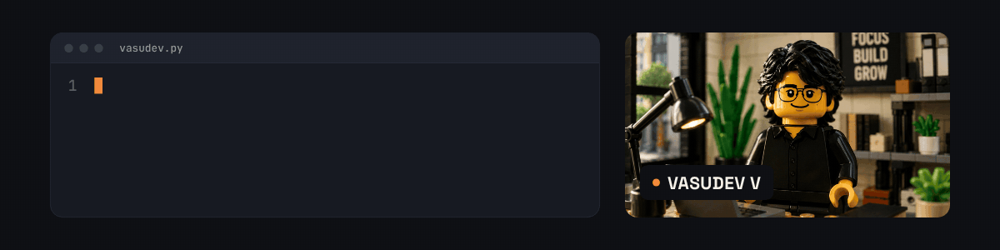
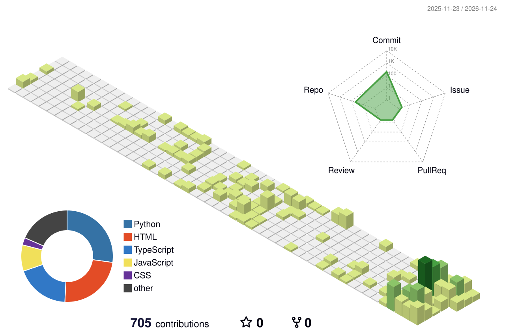

I build machine learning and computer vision systems, and I like taking them from a notebook to something people can actually use.

[Portfolio](https://vasu-uu.github.io/Portfolio/) · [LinkedIn](https://linkedin.com/in/vasudev-v-) · [Email](mailto:vasudev20057d@gmail.com) · [LeetCode](https://leetcode.com/u/RaQRG66LNK/)

## About

Final-year B.Tech CSE student at **Saintgits College of Engineering**, Kerala, specializing in AI/ML with a minor in AI for IoT. My work sits between applied machine learning, computer vision and agentic AI tooling. I've built face-recognition attendance software, a network intrusion classifier, and multi-agent assistants on LangGraph and Gemini. I care most about the unglamorous part: data cleaning, evaluation, and getting a model behind a working app.

## Now

<!-- [PLACEHOLDER] inferred from my most recently updated repos; edit to match what you are focused on -->
- [truthlens](https://github.com/Vasu-uu/truthlens): deepfake and AI-fraud checker for images, voice notes and scam messages
- [Duelscope](https://github.com/Vasu-uu/Duelscope): one-command benchmarking CLI to compare object detectors
- [react-agent-studio](https://github.com/Vasu-uu/react-agent-studio): a ReAct agent on LangGraph and Gemini with a chat UI

## Projects

| Project | What it does | Built with |
|:--|:--|:--|
| [TRACE Attendance System](https://github.com/Vasu-uu/TRACE-Attendance-System) | Face-recognition attendance that checks who is actually in the room, to stop proxy attendance | YOLOv8, FaceNet, OpenCV, Flask, MySQL |
| [PathMentor](https://github.com/Vasu-uu/PathMentor) | Multi-agent assistant that writes personalized study plans and explanations | LangGraph, Gemini API, Flask |
| [Network-Threat-Analyzer](https://github.com/Vasu-uu/Network-Threat-Analyzer) | Flags malicious network traffic: **93% accuracy, 0.93 F1** on UNSW-NB15 | Random Forest, scikit-learn |
| [Heart-Failure-Prediction](https://github.com/Vasu-uu/Heart-Failure-Prediction) | Estimates heart failure risk from clinical inputs (**83.33% accuracy**) | scikit-learn, Flask |
| [Crop-Recommendation-System](https://github.com/Vasu-uu/Crop-Recommendation-System) | Suggests the best crop for a farmer's soil and climate conditions | scikit-learn, Flask |
| [Complaint-Management-System](https://github.com/Vasu-uu/Complaint-Management-System) | Submit and track complaints, with an admin dashboard for the full lifecycle | Node.js, Express, MySQL |

More on my [repositories page](https://github.com/Vasu-uu?tab=repositories).

## Stack

| | |
|:--|:--|
| **Languages** | Python, C, SQL, JavaScript, HTML |
| **ML and vision** | YOLOv8, FaceNet / ArcFace, OpenCV, scikit-learn, PyTorch |
| **Agents** | LangGraph, Gemini API |
| **Backend** | Flask, Node.js, MySQL |
| **Tools** | Git, GitHub, VS Code |

## Experience

| When | Role | What I did |
|:--|:--|:--|
| Feb – Apr 2026 | **AI Intern**, Infosys Springboard (remote) | Annotated an image dataset, trained and evaluated a YOLOv8m detector, and validated it on unseen real-world data |
| May – Jul 2025 | **Industrial trainee**, Intel Unnati (remote) | Built a Random Forest intrusion detector on UNSW-NB15 (93% accuracy, 0.93 F1) with a Flask dashboard |

Leadership: Technical Lead, Saintgits Blockchain Club · PR Lead, AURA (Saintgits AI club)

## Certifications and achievements

- Oracle Cloud Infrastructure 2025 AI Foundations Associate <!-- [confirm current] -->
- Applied Generative AI, Infosys Springboard
- Claude Code in Action, Anthropic
- HackerRank: Python (5-star), SQL (3-star)
- 95+ problems solved on LeetCode

## Activity

<!-- Generated daily by .github/workflows/profile-3d.yml (static SVG in profile-3d-contrib/, so it always loads). -->

## Contact

The quickest way to reach me is [email](mailto:vasudev20057d@gmail.com) or [LinkedIn](https://linkedin.com/in/vasudev-v-). I'm always happy to talk about ML, computer vision or agents.
