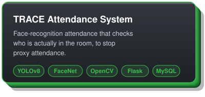
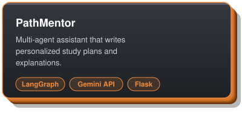
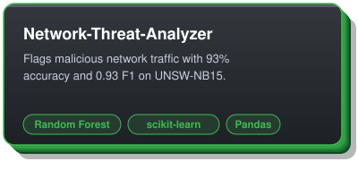
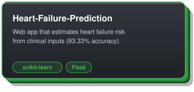
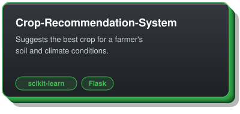
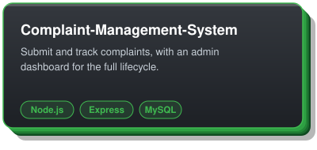

<div align="center">

**I build machine learning and computer vision systems, and I like taking them from a notebook to something people can actually use.**

<a href="https://vasu-uu.github.io/Portfolio/"></a>
<a href="https://linkedin.com/in/vasudev-v-"></a>
<a href="mailto:vasudev20057d@gmail.com"></a>
<a href="https://leetcode.com/u/RaQRG66LNK/"></a>

</div>

<br>

```python
class Vasudev:
    role     = "ML Engineer · Computer Vision · Agentic AI"
    studying = "B.Tech CSE (final year), Saintgits College of Engineering, Kerala"
    focus    = ["applied ML", "computer vision", "LLM agents and tooling"]
    minor    = "AI for IoT"
    habit    = "ship the model behind a working app, not just a notebook"
```

## 

<!-- [PLACEHOLDER] inferred from my most recently updated repos; edit to match what you are focused on -->
- 🛡️ [**truthlens**](https://github.com/Vasu-uu/truthlens): deepfake and AI-fraud checker for images, voice notes and scam messages
- 🎯 [**Duelscope**](https://github.com/Vasu-uu/Duelscope): one-command benchmarking CLI to compare object detectors
- 🤖 [**react-agent-studio**](https://github.com/Vasu-uu/react-agent-studio): a ReAct agent on LangGraph and Gemini with a chat UI

## 

<table>
<tr><td width="50%"><a href="https://github.com/Vasu-uu/TRACE-Attendance-System"></a></td><td width="50%"><a href="https://github.com/Vasu-uu/PathMentor"></a></td></tr>
<tr><td width="50%"><a href="https://github.com/Vasu-uu/Network-Threat-Analyzer"></a></td><td width="50%"><a href="https://github.com/Vasu-uu/Heart-Failure-Prediction"></a></td></tr>
<tr><td width="50%"><a href="https://github.com/Vasu-uu/Crop-Recommendation-System"></a></td><td width="50%"><a href="https://github.com/Vasu-uu/Complaint-Management-System"></a></td></tr>
</table>

<details>
<summary>More from my repositories</summary>
<br>

- [Loan-Approval-Prediction-System](https://github.com/Vasu-uu/Loan-Approval-Prediction-System): ML pipeline and dashboard for credit risk and loan eligibility
- [studylens-ai](https://github.com/Vasu-uu/studylens-ai): turns photos of notes and PDFs into summaries, flashcards and quizzes
- [ai-engineer-roadmap](https://github.com/Vasu-uu/ai-engineer-roadmap): interactive, checkable roadmap to becoming an AI engineer

</details>

## 

<table>
<tr><td><b>Languages</b></td><td></td></tr>
<tr><td><b>ML and vision</b></td><td> <code>YOLOv8</code> <code>FaceNet / ArcFace</code></td></tr>
<tr><td><b>Agents</b></td><td><code>LangGraph</code> <code>Gemini API</code></td></tr>
<tr><td><b>Backend</b></td><td></td></tr>
<tr><td><b>Tools</b></td><td></td></tr>
</table>

## 

| When | Where | What I did |
|:--|:--|:--|
| **Feb – Apr 2026** | **AI Intern**, Infosys Springboard (remote) | Annotated an image dataset, trained and evaluated a YOLOv8m detector, and validated it on unseen real-world data. |
| **May – Jul 2025** | **Industrial trainee**, Intel Unnati (remote) | Built a Random Forest intrusion detector on UNSW-NB15 (93% accuracy, 0.93 F1) with a Flask dashboard. |

Leadership: Technical Lead, Saintgits Blockchain Club · PR Lead, AURA (Saintgits AI club)

**Certifications:** Oracle OCI 2025 AI Foundations Associate <!-- [confirm current] --> · Applied Generative AI (Infosys Springboard) · Claude Code in Action (Anthropic) · HackerRank Python (5-star) and SQL (3-star) · 95+ LeetCode problems

## 

<!-- Generated daily by .github/workflows/profile-3d.yml (static SVG in profile-3d-contrib/, so it always loads). -->
<div align="center">

</div>

## 

The quickest way to reach me is [email](mailto:vasudev20057d@gmail.com) or [LinkedIn](https://linkedin.com/in/vasudev-v-). I'm always happy to talk about ML, computer vision or agents.
